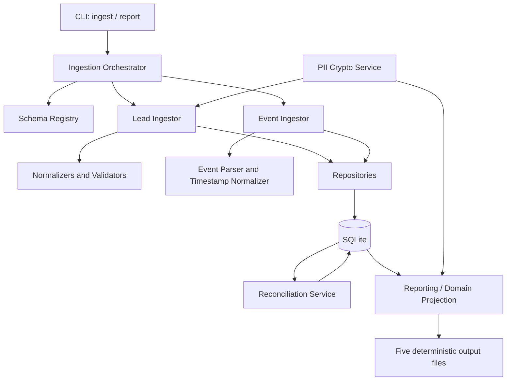

# Agentic Universe — Assignment A Engineering Blueprint

**Project:** Interaction Ledger & Reporting Pipeline  
**Chosen assignment:** A — Data  
**Language/runtime:** Python 3.11+  
**Database:** SQLite  
**Primary objective:** A correct, deterministic, privacy-preserving ingestion pipeline whose five report files match the assignment contract on an unseen data seed.

> This document is the implementation contract for the coding agent. Work phase by phase. Do not generate the entire application in one response. Do not proceed to the next phase until the current phase's acceptance checks pass.

---

## 0. Delivery strategy and priorities

The assignment explicitly values correctness on unseen seeds, data modelling, idempotency, robustness, readable code, tests and honest trade-offs. A clean, correct core is more valuable than a broad, partially working system.

### Priority order

1. **P0 — Exact contract correctness:** lead normalization, rejection, deduplication, event deduplication/linking, effective dispositions, buckets, all five reports.
2. **P0 — Privacy:** no plaintext schema-marked PII in SQLite; phone matching must still work.
3. **P0 — Incremental/idempotent ingestion:** safe reruns; drop 1 then drop 2; late event reconciliation.
4. **P0 — Reproducible setup and tests:** clean-clone commands work; one-command test run.
5. **P1 — Clear architecture and documentation:** explain assumptions, failure modes and trade-offs.
6. **P2 — Performance stretch:** benchmark only after all core checks pass. Do not sacrifice correctness for the 2-minute large-data target.

### Non-goals

- No web frontend, dashboard, REST API, LLM, agent framework, message broker or cloud deployment.
- No PostgreSQL requirement; SQLite is explicitly acceptable and reduces setup risk.
- No complex ORM or migration framework unless a concrete need appears. Prefer Python standard library plus a small number of dependencies.
- Do not implement Assignment B features.

### Time budget

The assignment recommends **6–8 focused hours**. The plan below targets about 8 focused hours and leaves a contingency window. Work should be phase-gated; if a phase takes longer, drop optional work rather than skipping tests. The invitation says the video round must happen before assignment submission; the remaining stated video window is Friday 13 November, 5:00–7:00 PM IST. Finish implementation and documentation before that window, complete the video round, then submit promptly. The email says 13 November EOD; do not wait until the last minute.

Suggested schedule (all times IST; shift only if the video is already complete or your actual availability differs):

| Window | Work | Exit condition |
|---|---|---|
| Thu 12 Nov, 7:15–7:35 PM | Repository audit, generate seed 42, map spec and schemas | Written checklist; original assignment inputs untouched |
| Thu, 7:35–8:35 PM | Package skeleton, schema registry, normalizers and PII foundation | Unit tests pass for normalizers and crypto |
| Thu, 8:35–9:20 PM | SQLite schema, transactions and file manifest | DB tests and file-level idempotency pass |
| Thu, 9:20–10:20 PM | Lead CSV ingestion, dedupe and rejections | Lead pipeline passes targeted tests |
| Fri 13 Nov, 8:30–9:45 AM | Event ledger, dedupe, matching and pending reconciliation | Late-lead and override tests pass |
| Fri, 9:45–11:00 AM | Derived call/disposition/bucket logic and five reports | Small seed produces exact report files |
| Fri, 11:00 AM–12:30 PM | End-to-end, idempotency, second-seed and edge-case testing | Full tests pass; discrepancies fixed |
| Fri, 12:30–1:00 PM | Break | Return fresh for final checks |
| Fri, 1:00–1:45 PM | `SUBMISSION.md`, `AI_USAGE.md`, setup/run commands | No placeholders or unsupported claims |
| Fri, 1:45–3:00 PM | Clean-clone verification, diff/security review, fix only blockers | Setup/run/test works; no secrets/data staged |
| Fri, 3:00–4:30 PM | Contingency buffer; no feature expansion | Final private repository ready |
| Fri, 5:00–7:00 PM | Video assessment window | Complete video before assignment submission |
| Immediately after video | Final push, verify repository access/submission form, submit | Submission confirmation saved |

**Cut line:** At 1:00 PM Friday, stop adding features. Only fix correctness, setup, documentation and submission blockers. Skip performance stretch unless every P0 acceptance check is already green.

---

## 1. Understand the business and the exact contract

A workflow (for example `motor_renewal`) has a schema defining the columns accepted in lead CSV files and a disposition catalogue defining which outcomes are terminal or successful. Operations deliver lead batches as CSV; the calling system delivers call events as JSON Lines. The pipeline produces reports used to assess calling outcomes.

The interaction ledger is the source of truth. **Events are facts and must not be rewritten to make reporting convenient.** Lead associations and report calculations are projections derived from those facts.

Read these repository files before implementation:

- `README.md`
- `assignment-a-data/README.md`
- `docs/GLOSSARY.md`
- `assignment-a-data/schemas/motor_renewal.json`
- `assignment-a-data/schemas/policy_feedback.json`
- `assignment-a-data/schemas/dispositions.csv`
- `assignment-a-data/tools/generate_data.py`
- `SUBMISSION.md`
- `AI_USAGE.md`

The supplied generator intentionally makes the inputs adversarial: it varies lead header aliases in `batch_003`, inserts blank CSV rows, distributes and duplicates leads across batches, shuffles JSONL events, duplicates event lines (including across drops), truncates some lines into malformed JSON, generates orphan events for rejected/unuploaded leads, and can place human overrides in a later drop than the original call. Therefore, never assume JSONL line order is chronological or that all events for a call arrive together. The generator also emits calls with no calls for some leads and one to four calls for others. See the generator itself for the precise current fixture behaviour; hidden tests may vary the seed.

The supplied schemas currently define:

- `motor_renewal`: `customer_name` (PII, required), `phone` (PII, required), `policy_number` (required reference), `policy_expiry` (optional date), `premium_amount` (optional decimal), `preferred_language` (optional enum, default `en`).
- `policy_feedback`: `customer_name` (PII, required), `phone` (PII, required), `order_id` (required reference), `product` (optional string), `order_date` (optional date), `preferred_language` (optional enum, default `en`).

Do not hardcode these field lists. Load schemas dynamically from the supplied JSON files.

### Required command interface

Implement and document an interface equivalent to:

```powershell
python -m solution.cli ingest data/drop_1
python -m solution.cli ingest data/drop_2
python -m solution.cli report --out reports/
```

It is also useful to support `ingest data/` recursively, processing nested drops in deterministic path order. The three commands above must work exactly as written from the repository root after setup.

### Exact lead rules

- Header normalization: lowercase, trim, replace every run of underscores or whitespace with one space. Match normalized schema `name` and `aliases`. Ignore unmatched columns.
- Blank rows (all cells empty/whitespace) are skipped and do not count toward row numbers or `lead_rows_total`.
- Data row numbers count **non-blank rows within each file**, starting at 1; header is not counted.
- Trim values; empty string becomes missing/null.
- Phone: strip all non-digits; if 12 digits beginning `91`, remove `91`; if 11 digits beginning `0`, remove `0`; then require exactly 10 digits beginning 6/7/8/9. Canonical stored form is `+91XXXXXXXXXX`.
- Date formats: `YYYY-MM-DD`, `DD/MM/YYYY`, `DD-MM-YYYY`, `DD-Mon-YYYY` (month case-insensitive). Day-first. Reject impossible dates.
- Decimal: optional prefix `₹`, `Rs`, `Rs.`, or `INR` (case-insensitive; optional whitespace); commas are thousands separators; value must be >= 0; round to 2 decimal places.
- Enum: case-insensitive match against schema `values`; store lowercase.
- Walk fields in schema order. First required-missing failure is `missing_required:<field_name>`. Present invalid phone is `invalid_phone`. Rejected row is not a lead.
- Invalid optional field becomes null and increments `field_warnings` once for that field on that otherwise accepted row. Missing optional values are not warnings. Rejected rows do not add field warnings.
- Identity: `(workflow_id, canonical phone)`.
- Process drops in invocation order, files in deterministic filename/path order, rows in file order. First valid identity creates the lead; its first file stem is its permanent `batch_id`. Each later valid row for that identity increments `duplicate_lead_rows_merged` and overwrites only non-null fields (last non-null value wins).
- Apply schema defaults only after merging, to fields still null. Prefer applying defaults in the report/domain projection rather than writing them as source data into the stored lead attributes.

### Exact event rules

Event types: `call.initiated`, `call.telephony_failed`, `call.connected`, `call.ended`, `disposition.set`, `disposition.override`.

For every JSONL file:

1. Every non-empty line increments `events_total`, even when malformed or duplicate. Empty/whitespace-only lines do not.
2. Invalid JSON or missing/blank `event_id` increments `malformed_events` and is skipped.
3. A previously seen `event_id` anywhere in any prior drop increments `duplicate_events_dropped` and is skipped.
4. If event cannot be associated to a valid lead, it is pending/unresolved and contributes to the **current final** `orphan_events` count until it can be reconciled. Do not permanently throw it away: a lead may arrive in a later drop.
5. Normal events link using `(workflow_id, normalized phone)`. `disposition.override` contains no phone and must link through `(workflow_id, call_id)` to another event for that call.
6. After an event is associated with a lead, a `disposition.*` event whose code is absent from the workflow's disposition catalogue increments `unknown_disposition_events` and has no effect on derived reports.
7. An event that is unresolved at the end of drop 1 but resolves after drop 2 must stop counting as an orphan. If its disposition is unknown, it then counts as unknown disposition instead.

Timestamps may be UTC (`Z`), offset-aware (for example `+05:30`) or naive (`YYYY-MM-DD HH:MM:SS`). Naive values mean IST. Store normalized timestamps in UTC for comparison; derive IST values for report dates/output using `Asia/Kolkata`.

### Derived facts

- A call exists/counts only when a linked `call.initiated` event exists.
- Call date is the IST date of `call.initiated`.
- Call is connected when a linked `call.connected` exists for the same workflow/call.
- Effective disposition for a call: latest `disposition.override` by `occurred_at`; if there is no override, latest `disposition.set`; otherwise none. Any override takes precedence over sets, even if a set has a later timestamp, because that is the written contract. Do not mutate/delete earlier events.
- Lead bucket precedence:
  1. `yet_to_reach_out` — zero calls.
  2. `completed` — any call has an effective disposition with `is_terminal=true`.
  3. `in_progress_telephony_failed` — every call has a `call.telephony_failed` event.
  4. `in_progress_dialed` — otherwise.

### Exact output contract

Write these five files with exact headers, lower-case booleans, no DataFrame index, correct delimiter and deterministic sorting:

1. `batch_summary.csv`, sorted `(workflow_id, batch_id)`:
   `workflow_id,batch_id,total_leads,yet_to_reach_out,in_progress_telephony_failed,in_progress_dialed,completed`
2. `daily_overview.csv`, one row per `(workflow_id, IST date)` having at least one call, sorted `(workflow_id, date)`:
   `workflow_id,date,total_calls,connected_calls,connectivity_rate,success_leads`
   - `connectivity_rate = connected_calls / total_calls`, exactly four decimal places.
   - `success_leads` is the number of distinct leads with at least one call on that date whose effective disposition has `is_success=true`.
3. `lead_report.csv`, one row per lead, sorted `(workflow_id, external_ref)`:
   `workflow_id,external_ref,batch_id,phone_masked,bucket,total_calls,connected_calls,last_call_at,current_disposition,ever_success`
   - external reference comes from schema field with `reference: true`.
   - phone mask is `+91******` plus last four digits.
   - `last_call_at` is latest `call.initiated` in ISO-8601 IST, e.g. `2026-10-14T17:55:24+05:30`; blank with no calls.
   - `current_disposition` is the effective disposition of the most recent call by initiated time **that has an effective disposition**; blank if none.
   - `ever_success` is true if any call's effective disposition has `is_success=true`.
4. `rejections.csv`, sorted `(workflow_id, batch_id, row_number)`, containing no PII:
   `workflow_id,batch_id,row_number,reason`
5. `data_quality.json` with these keys and meanings:
   - `lead_rows_total`: number of nonblank lead data rows read from each uniquely ingested lead file.
   - `lead_rows_rejected`: rejected lead rows.
   - `rejections_by_reason`: reason -> count.
   - `duplicate_lead_rows_merged`: later valid rows merged into existing lead identities.
   - `field_warnings`: invalid optional field values on accepted rows.
   - `events_total`: non-empty JSONL lines, including malformed and duplicate lines.
   - `malformed_events`: malformed JSON/missing event_id.
   - `duplicate_events_dropped`: duplicate event IDs.
   - `orphan_events`: valid, unique events still unresolved after all currently ingested leads/events have been reconciled (not a historical cumulative counter).
   - `unknown_disposition_events`: linked disposition events whose disposition code is not in the workflow catalogue.

---

## 2. Proposed architecture

Use a small layered modular monolith. Keep business rules in pure/service functions; keep filesystem, SQLite and CLI concerns at the edges.



### Layer responsibilities

- **CLI:** parse arguments, load configuration, initialize DB, invoke services, print concise summaries and non-sensitive errors. No business logic.
- **Ingestion orchestrator:** discover files, sort deterministically, compute SHA-256 fingerprints, enforce file-level idempotency and wrap each file's work in a transaction.
- **Schema registry:** load/validate workflow schemas and disposition catalogue from original assignment files. Do not duplicate schema definitions in code.
- **Normalizers:** pure functions for header, phone, date, decimal, enum and event timestamp normalization. Easy to unit test.
- **Lead ingestor:** parse CSV preserving column order, validate rows, write rejections, create/merge leads, preserve original batch attribution.
- **Event ingestor:** parse JSONL, count lines accurately, deduplicate event IDs globally, write immutable facts and current association state.
- **Reconciliation service:** after each lead/event file, resolve pending phone-based events, establish call-to-lead links and resolve pending overrides. Reconciliation must be repeatable and idempotent.
- **PII service:** authenticated encryption/decryption and deterministic keyed phone lookup digest. Do not log secrets or decrypted PII.
- **Repositories/database:** explicit SQL, foreign keys, unique constraints, transactions and indexes. Use parameterized SQL only.
- **Reporting/domain projection:** derive calls, effective dispositions, buckets and aggregates from linked ledger facts; serialize exact CSV/JSON contracts.

### Proposed source layout

```text
repository-root/
├── assignment-a-data/                 # supplied; DO NOT MODIFY
├── assignment-b-workflow/             # supplied; DO NOT MODIFY
├── docs/                               # supplied; DO NOT MODIFY
├── solution/
│   ├── __init__.py
│   ├── cli.py
│   ├── config.py
│   ├── db.py
│   ├── schema_registry.py
│   ├── domain/
│   │   ├── __init__.py
│   │   ├── models.py
│   │   └── rules.py
│   ├── security/
│   │   ├── __init__.py
│   │   └── pii.py
│   ├── ingestion/
│   │   ├── __init__.py
│   │   ├── discovery.py
│   │   ├── normalization.py
│   │   ├── leads.py
│   │   ├── events.py
│   │   └── reconciliation.py
│   ├── reporting/
│   │   ├── __init__.py
│   │   ├── calculations.py
│   │   └── writers.py
├── tests/
│   ├── conftest.py
│   ├── test_normalization.py
│   ├── test_lead_ingestion.py
│   ├── test_event_ingestion.py
│   ├── test_reconciliation.py
│   ├── test_derived_rules.py
│   ├── test_reports.py
│   └── test_idempotency.py
├── .env.example                      # placeholders only; never secrets
├── SUBMISSION.md                     # fill supplied template honestly
├── AI_USAGE.md                       # fill supplied template honestly
└── README.md                         # supplied; preserve unchanged
```

The repository already has a root `requirements.txt` with pytest and Assignment B mock-provider dependencies plus an explicit instruction to add dependencies below. Add only the Assignment A dependencies you actually use (for example `cryptography` and optionally `python-dotenv`) to that existing file; do not create a second competing requirements file. Keep supplied schemas, generator, original assignment README and glossary unchanged. Inspect the existing `.gitignore`; ensure generated databases, `.env`, `data/`, `data_large/`, `reports/`, caches and virtual environments are not committed without deleting existing ignore rules.

### Database model

Use SQLite with `PRAGMA foreign_keys=ON`, a sensible `busy_timeout`, and indexes for all lookup paths. A transaction should cover each source file's processing and its manifest record, so a crash cannot leave a file marked complete when only partly ingested.

Recommended tables:

| Table | Purpose | Important constraints/indexes |
|---|---|---|
| `ingestion_files` | One record per successfully processed source file; includes path, SHA-256, kind, workflow, batch, sequence/time and per-file stats | `source_path UNIQUE`; store content hash; immutable after success |
| `lead_batches` | Tracks every valid lead batch/file, including batches whose rows are all rejected | `UNIQUE(workflow_id, batch_id)` or link to file id |
| `leads` | One lead per workflow + deterministic phone digest; stores non-PII attributes and a PII ciphertext blob | `UNIQUE(workflow_id, phone_hmac)`; index `(workflow_id, external_ref)` |
| `rejections` | Non-PII rejection records | index `(workflow_id, batch_id, row_number)` |
| `events` | Immutable accepted event facts; do not include plaintext phone or raw JSON containing phone | `event_id PRIMARY KEY`; indexes `(workflow_id, call_id)`, `(phone_hmac, workflow_id)`, `(event_type, occurred_at_utc)` |
| `event_associations` | Mutable projection of association state for each immutable event | `event_id PRIMARY KEY`; nullable `lead_id`; status index |
| `call_links` | Resolves `(workflow_id, call_id)` to one lead for overrides | composite primary/unique key `(workflow_id, call_id)`; indexed by `lead_id` |

`events` should be append-only at the application layer. Prefer SQLite triggers rejecting UPDATE/DELETE on `events`, and test that they work. `event_associations` and `call_links` are derived operational state and may be updated during reconciliation; this does not mutate event facts.

#### PII storage design

- For every schema field with `pii: true`, store the value only inside authenticated ciphertext (e.g. Fernet/AES-based authenticated encryption from the `cryptography` package). Never put the raw row, raw CSV, plaintext customer name or plaintext phone into logs or the database.
- Store non-PII normalized attributes separately as JSON or typed columns.
- Store a deterministic HMAC-SHA256 digest for phone matching. Use a secret HMAC key from environment configuration; include workflow/domain separation in the HMAC input, e.g. `workflow_id + "|" + canonical_phone`.
- Encrypt the canonical phone as well, because reports must reveal only a masked form and any future authorized use should require decryption. For events, a phone HMAC alone is sufficient for matching; do not store plaintext event phone.
- Never hardcode encryption/HMAC keys. Fail fast with a clear non-secret error if required keys are absent. Provide `.env.example` with placeholders and document key generation. Do not commit `.env`.
- Tests should inject ephemeral keys through fixtures. Test that ciphertext decrypts correctly, HMAC equality is deterministic, different workflows are domain-separated, and raw PII strings do not appear in the SQLite database bytes or logs.
- Do not log normalized CSV row dictionaries, event JSON, phone values, ciphertext keys or decrypted PII.

#### Idempotency and file manifest

- Resolve each input file to an absolute canonical path and compute SHA-256 before processing.
- If the same source path and hash already has a completed manifest row, skip it and make no changes or counter increments.
- If the same path is encountered with a different hash, fail clearly rather than silently double-ingesting mutated input. Explain the reset/new-path procedure.
- Record the manifest row and processing statistics inside the same transaction as that file's data.
- Different paths with identical contents are not automatically interchangeable: they may represent distinct batches. Use path identity for file idempotency and event_id/lead identity for semantic deduplication.
- Process files in deterministic order. Preserve the order in which `ingest` invocations are made; sort files within each invocation. If ingesting a parent folder recursively, sort full relative paths so `drop_1` precedes `drop_2`.

---

## 3. Critical algorithms and invariants

### A. Lead CSV ingestion

1. Discover each CSV under `leads/<workflow_id>/`; workflow ID comes from the directory, batch ID from `Path.stem`.
2. Load the workflow JSON schema. Fail clearly for an unknown workflow or malformed schema.
3. Read CSV with `csv.reader` rather than relying solely on `DictReader`, so duplicate/aliased headers and original column positions can be handled deterministically.
4. Normalize headers using the exact rule. Map matching header positions to schema fields. Ignore unknown columns. If multiple source headers map to the same field, pick a deterministic rule (recommended: first matching column from left to right) and document it.
5. Walk nonblank rows; increment the logical row number only for nonblank data rows.
6. Normalize values in schema order. Preserve the first rejection reason exactly as the spec states. Do not write any rejected row's PII to `rejections`.
7. For accepted rows, encrypt PII fields, compute the workflow-scoped phone HMAC, and build non-PII attributes.
8. Insert new lead or merge into existing `(workflow_id, phone_hmac)` lead. On merge, update only fields whose normalized value is non-null; do not change original `batch_id` or original creation identity. Increment duplicate counter once per later valid row, not once per updated field.
9. Apply defaults only in the derived/report view to fields still null after all merged source values.
10. Persist the batch/file record even if every nonblank row is rejected so `batch_summary.csv` can represent an ingested empty batch with zero valid leads. If evidence in the generator contradicts this, follow the fixtures and document the choice.

### B. Event ingestion and reconciliation

Keep two concepts separate:

- **Immutable event fact:** event_id, type, workflow, call_id, UTC timestamp, phone HMAC if present, safe payload fields, source file/line metadata.
- **Current association projection:** `pending_lead`, `pending_call_link`, `linked`, `ignored_unknown_disposition` (plus a carefully handled conflict/error state only if required).

Processing a non-empty line:

1. Increment file `events_total`.
2. Parse JSON; on invalid JSON or missing/blank event_id increment `malformed_events` and skip.
3. Check global event_id. If already stored, increment `duplicate_events_dropped` and skip.
4. Normalize occurred_at. Naive values are interpreted as Asia/Kolkata, then converted to UTC for storage/comparison.
5. For a normal phone-bearing event, normalize the phone with the same phone function and compute the same workflow-scoped HMAC. If an event phone is invalid, do not classify the line as malformed: retain the valid unique event fact without a phone digest and leave its association pending permanently, so it contributes to final `orphan_events`. For `disposition.override`, phone is absent; leave phone HMAC null.
6. Insert immutable event once. Do not store the raw JSON line because it may contain PII.
7. If normal event phone HMAC matches a lead, associate it and establish/verify a `(workflow_id, call_id) -> lead_id` mapping. Otherwise mark `pending_lead`.
8. For an override, use an existing call link if available; otherwise mark `pending_call_link`.
9. After each lead file and event file, run reconciliation in a transaction:
   - Resolve all `pending_lead` events whose phone HMAC now matches a lead.
   - Any newly linked event with call_id establishes the call link.
   - Resolve all `pending_call_link` overrides for that workflow/call_id.
   - Once an event is linked, check disposition catalogue. If a `disposition.*` code is unknown for that workflow, set association status `ignored_unknown_disposition`; it remains in immutable event history but is excluded from derived metrics.
   - Leave events with no matching lead/call link pending. Their count is the current `orphan_events`.
10. A duplicate event ID across drop 1/drop 2 counts as a duplicate line in drop 2 but never creates a second ledger fact.

**Important:** The spec says event processing order is malformed → duplicate → orphan → unknown disposition. Do not count a not-yet-linkable unknown disposition as unknown until it is associated with a valid lead. A later lead can change the event from pending/orphan to ignored-unknown.

#### Call-link conflict handling

The assignment does not define what happens if the same `(workflow_id, call_id)` appears associated with two different leads. Do not silently reassign a call to another lead. Prefer first valid association wins; quarantine/log the conflicting association without including it in reports, and document this assumption. Keep logs free of PII. Confirm whether the generator can produce this case before spending time implementing complex handling.

### C. Derived call facts

Build a deterministic in-memory projection from linked, report-eligible events (not pending and not ignored-unknown disposition events). Group by `(workflow_id, call_id)` and associated lead.

For each call:

- Require a linked `call.initiated` event; otherwise it is not a reportable call.
- Select call initiation time as earliest or unique `call.initiated` time if duplicate initiations are possible; inspect generator semantics. Do not count multiple initiation events for one call as multiple calls.
- `connected = any(call.connected)` for call.
- `telephony_failed = any(call.telephony_failed)` for call.
- Latest `disposition.override` by occurred_at wins if any exist; else latest `disposition.set`; else no effective disposition.
- Look up `is_terminal` and `is_success` using `(workflow_id, disposition_code)` from `dispositions.csv`.
- All timestamp comparisons use timezone-aware UTC datetimes. Report date and display time use Asia/Kolkata.

For each lead:

- Total calls = count of its distinct reportable calls.
- Connected calls = count of those calls with connected event.
- Bucket = exact precedence above.
- Last call timestamp = maximum initiated timestamp among calls.
- Current disposition = effective disposition for the latest initiated call among calls that have a disposition; if the latest call has no disposition, choose the latest earlier call that does have one, per output contract.
- Ever success = at least one effective disposition on any call is successful.

For daily overview:

- Group calls by workflow and IST date of initiated event.
- Total calls = distinct reportable calls.
- Connected calls = connected distinct calls.
- Connectivity rate = decimal division to four decimal places; guard zero denominator (there should be no group with zero calls).
- Success leads = distinct leads whose call on that date has an effective successful disposition. Do not count calls or dispositions as leads.

### D. Report writing

- Use Python `csv.writer` / `csv.DictWriter` and explicit column order; do not use pandas.
- Use `newline=""` while opening CSV files; choose UTF-8 and `\n` consistently.
- Write all output headers even when there are zero data rows.
- Use lowercase `true`/`false` strings for CSV booleans. Blank strings for missing timestamps/dispositions.
- Sort using exact sort keys. For text sort use ordinary Python Unicode lexicographic order unless fixtures show a different rule.
- Write `data_quality.json` with stable key order matching the contract; sort `rejections_by_reason` deterministically. Use indentation for readability. Keep counts as integers.
- Reports must be reproducible: same database state must produce byte-identical report files.

---

## 4. Phased implementation plan for the coding agent

Each phase prompt below can be copied to Freebuff/OpenCode separately. The agent must inspect the current code before acting, make the smallest coherent change, run the specified tests, then report changed files, commands and results. It must not start the next phase without approval.

### Phase 0 — Repository reconnaissance (20–30 minutes)

**Prompt to agent:**

> Read the full root README, Assignment A README, glossary, both workflow schemas, disposition catalogue, generator, submission template and AI usage template. Inspect the current repository tree and existing requirements/.gitignore. Do not edit anything yet. Produce a concise requirements matrix mapping each rule to a proposed module and test. Identify any ambiguous generator-specific details (call_id semantics, disposition rows, input layout). Do not invent answers. Report the exact existing files that must remain unchanged and any risks. Stop for review.

**Acceptance gate:** A requirements matrix exists; no files were changed; both schemas and the generator are understood.

### Phase 1 — Project skeleton, config, schema registry, normalization and crypto (60–75 minutes)

**Prompt to agent:**

> Implement only the package skeleton, configuration, schema/disposition loading, pure normalization functions and PII security service. Do not implement ingestion or reports yet. Use Python 3.11+, type hints, small functions and clear exceptions. Load schema JSON dynamically; do not hardcode current field names. Implement exact header, phone, date, decimal, enum and event timestamp rules. Decimal calculations must use `Decimal`, not float. Implement authenticated encryption and workflow-scoped HMAC lookup using keys supplied by environment/.env. Never hardcode keys or log plaintext PII. Add focused pytest unit tests and dependency list. Run all tests and stop.

**Acceptance checks:**

- Header underscores/whitespace collapse correctly; aliases map as expected.
- Phone variants with spaces, punctuation, `91`, and leading `0` normalize exactly; invalid leading digits/length rejected.
- All four accepted date formats parse; impossible dates fail; `DD-Mon-YYYY` is case-insensitive.
- Decimal prefixes/commas/negative values/rounding are covered with Decimal.
- Enum normalization is case-insensitive.
- Naive event timestamp is IST; `Z` and offsets convert to the same UTC instant when equivalent.
- Encryption round-trip works; HMAC is stable and workflow-scoped; no key literal in source.

### Phase 2 — Database and file-level idempotency (45–60 minutes)

**Prompt to agent:**

> Implement SQLite connection/configuration, schema creation, repositories and file manifest only. Use explicit SQL and transactions. Define tables for ingestion_files, lead_batches, leads, rejections, immutable events, event_associations and call_links. Add unique constraints and indexes based on the blueprint. Store PII ciphertext and phone HMAC only; never plaintext. Add append-only protection for events. Implement canonical path + SHA-256 file identity: same path/hash is skipped; changed content at same path fails clearly. Include per-file counters persisted atomically with processing. Add tests for transaction rollback, unique constraints, path idempotency and event immutability. Do not implement full parsers yet. Stop after tests pass.

**Acceptance checks:** DB can be initialized repeatedly; foreign keys are active; event update/delete are rejected; re-ingesting same file manifest is no-op; modified same path fails without partial writes.

### Phase 3 — Lead ingestion (60–75 minutes)

**Prompt to agent:**

> Implement CSV discovery and lead ingestion according to the exact Assignment A README. Use the dynamic schema registry and pure normalizers. Preserve physical column order and handle alias matching deterministically. Skip blank rows without incrementing logical row_number. Store only encrypted PII and keyed phone digest. Record rejected rows without PII. Merge by `(workflow_id, phone_hmac)`: first valid file stem remains batch_id; later rows overwrite only non-null fields; count one duplicate per later valid row. Apply defaults only in the reporting projection, not by overwriting source attributes. Persist batch/file stats in the same transaction. Add unit and integration tests. Do not implement event ingestion or reporting. Stop after tests pass.

**Acceptance checks:** Required/invalid phone rejection priority; optional invalid field warning only on accepted rows; blank-row numbering; aliases/reordered columns; extra columns ignored; duplicate merge semantics; first batch retained; PII absent in DB bytes; rerunning a file changes nothing; both workflows handled by schema not hardcoded field lists.

### Phase 4 — Immutable event ledger, dedupe and reconciliation (75–90 minutes)

**Prompt to agent:**

> Implement JSONL ingestion and the reconciliation service only. Apply exact line counting: every non-empty line increments events_total; malformed JSON or missing/blank event_id increments malformed; globally repeated event_id increments duplicate and does not add an event. Do not persist raw event JSON or plaintext phone. Store phone HMAC for normal events. Keep event facts immutable and association state separate. Resolve phone-based events when matching leads exist; resolve overrides via `(workflow_id, call_id)` using other linked call events. Preserve unresolved events so a later lead/call event can resolve them. After association, mark unknown disposition events as ignored and exclude them from reports. `orphan_events` must be computed from still-pending associations, not historical orphan counters. Add tests for duplicate IDs across files, malformed lines, event-before-lead, override-before-call-event, unknown disposition before/after reconciliation, and idempotent reruns. Stop after tests pass.

**Acceptance checks:**

- Drop 1 with event but no lead produces pending/orphan count.
- Drop 2 with matching lead resolves the earlier event and lowers orphan count.
- A now-linked unknown disposition moves to unknown count.
- Override with no phone resolves only after a call link appears.
- Duplicate event ID across drops is counted once as duplicate line and never duplicated in ledger.
- Event facts cannot be updated or deleted.

### Phase 5 — Derived domain logic and five reports (75–90 minutes)

**Prompt to agent:**

> Implement report/domain projection and exact five output writers. Read only linked, report-eligible events. Build one call per `(workflow_id, call_id)` only when a linked call.initiated exists. Implement connected flag, telephony failure flag, effective disposition (latest override if any, otherwise latest set), terminal/success lookups, exact lead bucket precedence, lead-level counts/current disposition/ever_success, daily metrics and batch summary. Convert all report date/time values to Asia/Kolkata. Use explicit CSV header order, sorting, lowercase booleans, 4-decimal connectivity rate, blank values where specified, no PII in rejections. Output stable JSON with all required counters. Add tests for each rule and report schema. Stop after tests pass.

**Acceptance checks:** Every report has exact header/order/sort; no calls without initiated event; one call counted once; distinct success_leads; overrides take precedence; all bucket precedence cases; last_call_at/current_disposition edge case; IST day boundary; empty reports still have headers/keys.

### Phase 6 — End-to-end integration and adversarial testing (75–90 minutes)

**Prompt to agent:**

> Run the supplied generator with seed 42 and the small scale. In a clean temporary DB, run ingest drop_1, ingest drop_2, then report. Inspect all five files. Re-run both ingests and verify byte-identical outputs and unchanged DB row counts/counters. Test ingesting the parent data directory if supported. Generate a second unseen seed (e.g. 123) and run the same flow. Add focused adversarial tests for: alias headers/reordered columns, whitespace-only rows, invalid/optional values, duplicates across batches, malformed and duplicate events, events before leads, overrides before call links, UTC/offset/naive timestamps around IST midnight, multiple dispositions, terminal/success combinations, every-call telephony failure, and report sorting. Fix root causes, not just fixture-specific output. Run `pytest` and stop.

**Acceptance checks:** All tests pass on both seeds; no output depends on seed-specific IDs or hardcoded row counts; drop-by-drop result equals a single parent-folder ingestion result when file order is equivalent; reruns are no-ops.

### Phase 7 — Documentation, clean-clone verification, submission hygiene (45–60 minutes)

**Prompt to agent:**

> Complete the supplied SUBMISSION.md template and AI_USAGE.md honestly. Document architecture, schema, PII model, idempotency, late-event reconciliation, assumptions, failure modes, tests, actual measured results and remaining limitations. Add exact PowerShell and/or cross-platform setup, key configuration, generator, ingest, report and test commands. Do not claim tests or performance numbers that were not run. Verify no generated data, database, reports, .env, keys, caches or virtual environment are staged. Preserve original assignment input files. Do not invent reviewer handles or submission email; use only details supplied by the hiring team/form. Run the documented commands from a fresh clone or clean working copy. Stop and provide a final checklist.

**Acceptance checks:** No italics/placeholders remain in submission docs; AI usage honest; clean setup/run/test command works; repository remains private; only intended source/docs committed.

### Phase 8 — Optional performance stretch (only if core is green)

Measure the small dataset first. If time remains, generate the large dataset and benchmark total ingestion and report duration using `time.perf_counter()`. Record machine, Python version, scale, seed, input counts and real observed timings. Optimize only measured bottlenecks (batch inserts, indexes, query count, streaming). Do not implement SQL-only aggregation just to appear advanced. The stretch goal is optional; no fabricated result.

---

## 5. Required test matrix

| Area | Required cases |
|---|---|
| Header mapping | case, leading/trailing spaces, repeated underscores/spaces, aliases, unknown column, reordered columns |
| Row handling | blank row skipped, logical row numbers, short rows, empty values |
| Phone | 10-digit valid, `91` prefix, leading `0`, punctuation, invalid length, invalid first digit |
| Date | all accepted formats, month case, impossible date, ambiguous day-first example |
| Decimal | each prefix, comma thousands, zero, negative, >2 decimal places, rounding |
| Enum | mixed case, invalid optional value, missing optional value |
| Validation | first failure in schema order; required missing; invalid phone; optional warning; rejected row has no warning |
| Lead merge | same phone/workflow duplicate, same phone across workflows, null does not overwrite, non-null overwrites, first batch retained, defaults after merge |
| PII | DB does not contain plaintext name/phone, encryption decrypts, HMAC lookup, workflow separation, secrets not logged |
| File idempotency | same path/hash rerun, changed path content, crash/rollback, two different source paths |
| Events | malformed JSON, missing/blank ID, duplicate within file, duplicate across drops, empty lines, invalid event phone remains orphan, event before lead |
| Overrides | override without phone, override before call events, latest override, override precedence over later set, unknown override |
| Time | UTC Z, offset, naive IST, equivalent instant, IST date rollover |
| Call metrics | initiated required, connected, telephony failure, duplicate call events, multiple calls per lead |
| Buckets | no calls, terminal disposition, all calls telephony failed, mixed failure/nonfailure |
| Reports | exact headers, sorting, formatting, blank values, success lead distinct count, batch ownership, JSON keys/counts |
| Integration | seed 42 drop1→drop2, rerun, fresh seed, parent-folder ingest equivalence |

---

## 6. Execution rules for Freebuff / OpenCode

Paste this as the agent's project-level instruction before Phase 0:

> You are acting as a careful senior Python backend engineer implementing a time-boxed engineering assessment. The repository's Assignment A README is the source of truth. Read it and the supplied schemas/generator before coding. Use this blueprint as the implementation plan, but if the original assignment contradicts this document, the original assignment wins; report the discrepancy before making a design choice.
>
> Work only on the currently requested phase. Do not generate the whole project in one pass. First inspect existing files, then propose the smallest change set, implement it, run tests, inspect the diff, and report the exact result. Do not advance phases automatically.
>
> Never modify supplied assignment data, schemas, generator, Assignment B files or original instructions. Keep the solution focused and understandable. No frontend, LLM or unnecessary framework. Use Python 3.11+, type hints, small cohesive modules, explicit SQL, parameterized queries, transactions and deterministic output.
>
> Correctness rules are non-negotiable: schema-driven lead parsing; exact validation/rejection order; duplicate merge semantics; PII encryption and HMAC matching; globally unique event IDs; immutable event facts; pending event reconciliation when later leads/call links arrive; unknown-disposition processing only after association; timestamps compared in UTC and reported in IST; exact report contract; file-level idempotency.
>
> Never store/log plaintext PII, raw event JSON containing phone, API keys or encryption keys. Never commit generated data, DBs, reports, `.env`, caches or virtual environments. Never fabricate test output, performance measurements or documentation claims.
>
> After each phase, return: (1) files changed, (2) design decisions, (3) tests added, (4) exact commands run, (5) actual test results, (6) known gaps, (7) whether acceptance criteria passed. If a requirement is ambiguous, inspect the generator/fixtures and identify the assumption; do not silently invent behaviour.

### Agent collaboration rule

- Use **one implementation agent at a time** (Freebuff as primary).
- Use OpenCode as a reviewer only after a phase is implemented: ask it to inspect the diff and tests without editing files. Give it the original assignment README and this blueprint. Ask for concrete counterexamples, not generic praise.
- Do not have two agents write the same files concurrently.
- The human operator must understand each phase's core design and review the diff. The interview includes a live code change; do not submit code you cannot explain.

---

## 7. Submission-ready command flow

Use the exact actual package/module names chosen in implementation. Preferred commands from repository root in PowerShell:

```powershell
# 1. Create environment (once)
py -3.11 -m venv .venv
.\.venv\Scripts\Activate.ps1
python -m pip install --upgrade pip
python -m pip install -r requirements.txt

# 2. Configure local secrets (once per terminal/session; never commit these)
# Generate a Fernet key and a separate high-entropy HMAC key using the documented helper.
# Put values in a local .env ignored by Git (loaded by python-dotenv), or set environment variables.

# 3. Generate synthetic data
python assignment-a-data\tools\generate_data.py --seed 42 --scale small --out data

# 4. Ingest incrementally
python -m solution.cli ingest data\drop_1
python -m solution.cli ingest data\drop_2

# 5. Produce reports
python -m solution.cli report --out reports

# 6. Run tests
python -m pytest -q
```

Also document the equivalent commands for macOS/Linux if straightforward. The assignment says the clean-clone commands must work; test them from a fresh clone/working copy rather than relying on a previously initialized local DB.

---

## 8. Final review checklist (do not submit until checked)

### Correctness
- [ ] Both workflow schemas are loaded dynamically; field names/types are not hardcoded.
- [ ] Files/rows/events are processed in deterministic order.
- [ ] Blank lead rows and blank event lines are treated correctly.
- [ ] Rejection reason is exactly the first applicable reason in schema order.
- [ ] Optional invalid values are null + warning only on accepted rows.
- [ ] Duplicate leads preserve first batch and merge non-null fields only.
- [ ] Default values are applied after merge.
- [ ] Duplicate event IDs are global across all drops.
- [ ] Late events are reconciled when leads arrive; final orphan count is dynamic.
- [ ] Overrides without phone resolve through call_id.
- [ ] Unknown dispositions count only after event association.
- [ ] Calls require linked `call.initiated` events.
- [ ] Effective disposition and lead bucket precedence match the spec.
- [ ] All reports have exact headers, sorting, date semantics and formatting.

### Security and reliability
- [ ] No plaintext `pii: true` fields in DB.
- [ ] No raw phone in event table or logs.
- [ ] Keys come from local environment and are not committed.
- [ ] Event fact table is append-only.
- [ ] File processing + manifest is transactional.
- [ ] Re-running the same drops is a no-op.
- [ ] Generated data, DBs, reports, `.env`, keys and caches are not staged.

### Delivery
- [ ] `python -m pytest -q` passes.
- [ ] Small seed and at least one fresh seed pass.
- [ ] Clean-clone setup and commands work.
- [ ] `SUBMISSION.md` is complete and honest.
- [ ] `AI_USAGE.md` is complete and honest.
- [ ] No placeholder reviewer handles/email are invented.
- [ ] Repository is private.
- [ ] Video assessment completed before assignment submission.
- [ ] Submission form/email instructions followed and confirmation saved.

---

## 9. Known specification ambiguities to inspect and document

Do not block implementation waiting for the hiring team. Inspect the generator and fixtures, make the simplest deterministic choice and document it in `SUBMISSION.md`:

1. Two CSV headers mapping to the same schema field: recommended first matching column left-to-right.
2. Whether a batch with zero accepted leads appears in `batch_summary.csv`: recommended yes, because it is still an ingested batch and can be represented with `total_leads=0`; verify generator expectations.
3. Multiple `call.initiated` events or conflicting phone-to-call mappings: inspect generator. A call should count once by call_id; do not silently associate one call with multiple leads.
4. Malformed non-JSON event with no ID is clearly malformed. For structurally valid JSON with missing non-ID fields or invalid timestamp, inspect generated data; the assignment does not define a separate counter for those cases. Avoid inventing new output keys.
5. Decimal half-way rounding mode is not stated. Use `Decimal` with a documented, consistent financial rounding mode (recommended `ROUND_HALF_UP`) and verify fixtures.
6. Stable ordering of JSON object keys is not explicitly stated; preserve the contract's top-level key order and sort dynamic rejection-reason keys deterministically.

If an ambiguity is not exercised by the provided generator, state the chosen behaviour and its reason. Do not overbuild speculative handling at the expense of core correctness.

---

## 10. Definition of done

The project is done when a reviewer can clone the private repository, follow the documented setup, generate a fresh synthetic seed, run the two ingestion commands and report command, run the tests with one command, and understand from `SUBMISSION.md` how the database, event ledger, PII strategy, late-event reconciliation and report calculations work.

**The strongest submission is not the one with the most code. It is the smallest implementation that is demonstrably correct, secure, reproducible and easy to defend.**
