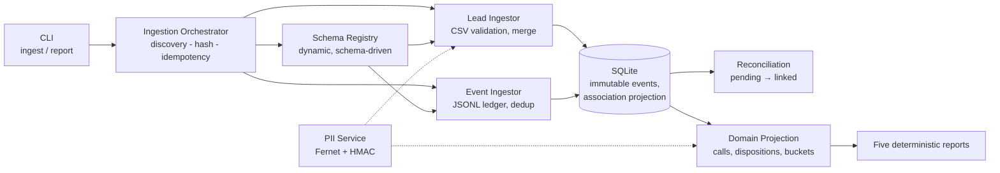

# Interaction Ledger & Reporting Pipeline

**A privacy-preserving ingestion and reporting system for lead and call-interaction data — built to stay correct on data it has never seen.**

   

---

## What this is

Operations delivers lead batches as CSV. The calling system delivers call events as JSON Lines — out of order, duplicated, occasionally malformed, sometimes for leads that have not arrived yet. This pipeline turns that chaos into an **append-only interaction ledger** and five exact, deterministic reports.

It is engineered around four constraints that are easy to state and hard to get right:

| Constraint | How it is met |
|---|---|
| **Never lose or corrupt a fact** | Events are immutable, append-only rows protected by database triggers; each file's data and statistics persist transactionally, with crash-safe manifest recovery |
| **PII protection** | `pii: true` fields are Fernet-encrypted before persistence; phones are matched via workflow-scoped HMAC-SHA256 digests — raw database and report scans verified tested values were never stored or exposed as plaintext |
| **Safe to run twice** | File-level idempotency (canonical path + SHA-256) plus semantic deduplication (lead identity, global `event_id`); reruns are byte-identical no-ops |
| **Late data is normal** | Events that arrive before their leads stay *pending*, not discarded — reconciliation links them when the lead shows up |

---

## Architecture



Business rules live in pure functions; filesystem, SQLite and CLI concerns stay at the edges. Every timestamp is compared in UTC and rendered in IST (`Asia/Kolkata`).

---

## Quick start

Requires **Python 3.11+**.

```powershell
# 1. Environment (once)
python -m venv .venv
.\.venv\Scripts\Activate.ps1
python -m pip install -r requirements.txt

# 2. Keys (once per environment) — never committed
#    Copy .env.example to .env and follow its key-generation instructions,
#    or set ENCRYPTION_KEY / HMAC_KEY directly in your shell.

# 3. Data (supplied generator, any seed)
python assignment-a-data\tools\generate_data.py --seed 42 --scale small --out data

# 4. Ingest incrementally — safe to rerun at any time
python -m solution.cli ingest data\drop_1
python -m solution.cli ingest data\drop_2

# 5. Reports
python -m solution.cli report --out reports

# 6. Tests
python -m pytest -q
```

`ingest` also accepts a parent folder (`python -m solution.cli ingest data`) and processes nested drops in deterministic path order — producing results identical to drop-by-drop ingestion.

---

## The five reports

| File | Contents |
|---|---|
| `batch_summary.csv` | Leads per workflow/batch by bucket: `yet_to_reach_out`, `in_progress_telephony_failed`, `in_progress_dialed`, `completed` |
| `daily_overview.csv` | Per workflow + IST day: call volume, connectivity rate (4 dp), distinct successful leads |
| `lead_report.csv` | Per lead: bucket, call counts, last-call time (ISO-8601 IST), effective disposition, `ever_success` |
| `rejections.csv` | Rejected rows with first-failure reason — contains no PII |
| `data_quality.json` | Ten ingestion-quality counters, including the *current* orphan-event count |

All outputs have exact headers, deterministic sort order, lowercase booleans, and no DataFrame artifacts. Regenerating reports from unchanged data produces **byte-identical files**.

---

## Design decisions

- **SQLite over PostgreSQL** — explicitly acceptable, zero-setup, and fully sufficient for the workload; correctness beats infrastructure theater.
- **Explicit SQL, no ORM** — every query is parameterized and reviewable; constraints and indexes are declared, not implied.
- **Encryption and matching are separate concerns** — Fernet for confidentiality of PII at rest, HMAC-SHA256 for equality search without decryption. Different keys, both from the environment.
- **Facts are never rewritten** — a human `disposition.override` takes precedence over a later `disposition.set` because the contract says so; earlier events remain in the ledger untouched.
- **Unknown dispositions are retained, not dropped** — they remain in the event ledger, are counted once their events associate with leads, and are excluded from derived disposition metrics.
- **Rejections reveal nothing** — rejection records carry workflow, batch, row number and reason only.

## Trade-offs and assumptions

- Duplicate CSV headers mapping to one schema field: first matching column left-to-right wins.
- A batch whose rows are all rejected still appears in `batch_summary.csv` with `total_leads=0` — it was ingested.
- An event without a parseable `occurred_at` cannot be placed on a timeline and is counted as malformed; this keeps one bad line from aborting an entire file.
- Manifest creation and data processing are not one atomic transaction; pending manifests are recoverable through replay and semantic deduplication.
- Decimal values use explicit `ROUND_HALF_UP` rounding to two places; comma grouping must be valid Western (`1,234,567`) or Indian (`1,23,456`) style — malformed grouping is rejected, not collapsed.
- Call-link conflicts (same call mapped to two leads) resolve first-association-wins; never silently reassigned.

---

## Testing

**182 tests, all passing** (`python -m pytest -q`), covering:

- Normalization edge cases — header aliases, phone variants (`+91`, `0`-prefix, punctuation), all four date formats, currency prefixes, enum casing, decimal grouping (Western and Indian; malformed rejected)
- Validation semantics — first-failure rejection priority, warnings only on accepted rows, blank-row numbering
- Duplicate handling — lead merges across batches, duplicate event IDs within and across drops
- Reconciliation — events before leads, overrides before call links, orphan counts that decrease when late leads arrive
- Persistence — foreign keys, unique constraints, event immutability triggers, transaction rollback
- Security — ciphertext round-trips, workflow-separated HMAC, and byte-level scans proving no plaintext PII at rest
- End-to-end — three independent generator seeds, idempotent reruns, parent-folder equivalence, empty-input behavior

## Project structure

```
solution/
├── cli.py                  # CLI entry point
├── config.py               # Environment/.env configuration
├── db.py                   # Schema, triggers, repositories
├── schema_registry.py      # Dynamic workflow/disposition loading
├── security/pii.py         # Fernet encryption, HMAC matching
├── ingestion/
│   ├── discovery.py        # File discovery, SHA-256 idempotency
│   ├── normalization.py    # Pure normalizers (phone/date/decimal/enum/time)
│   ├── leads.py            # CSV lead ingestion + merge
│   ├── events.py           # JSONL ledger + reconciliation
├── domain/calculations.py  # Calls, dispositions, buckets projection
└── reporting/writers.py    # Exact-contract report writers
tests/                      # 182 tests (unit, integration, adversarial, security)
```

---

## Assessment

Developed as a private technical assignment submission
for Agentic Universe.
